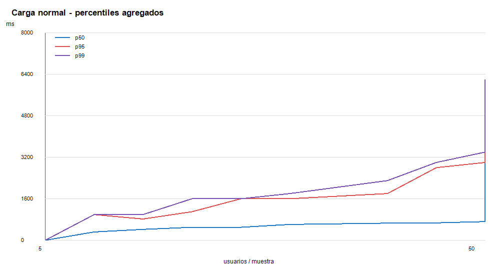
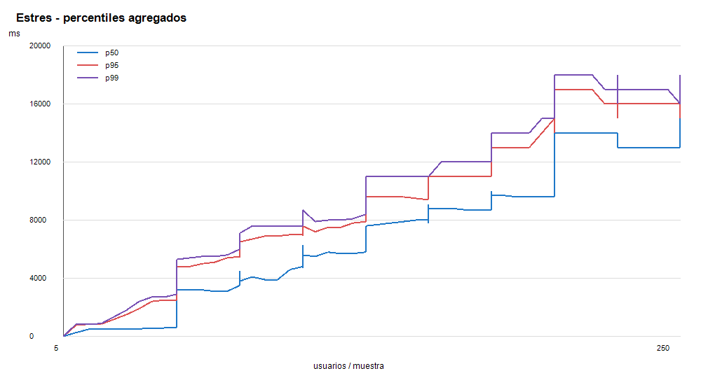
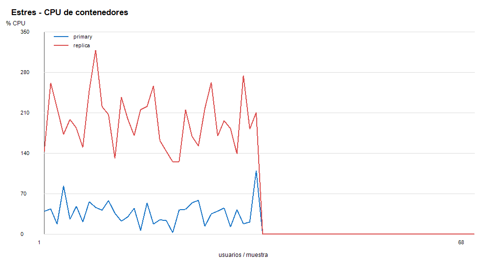
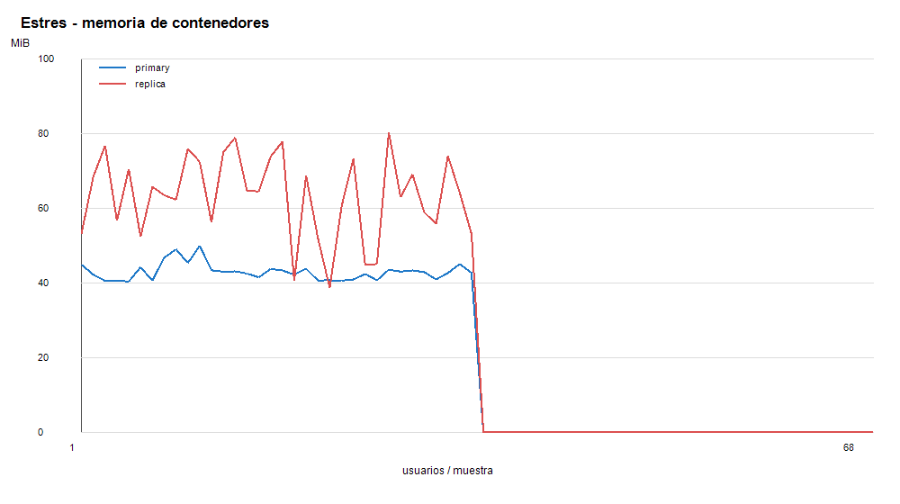

# TP10 — Monitoreo, evaluación de desempeño y optimización

## 1. Objetivo y aclaración importante

Evaluar el desempeño del backend del TP8 bajo carga normal y bajo una rampa de estrés, identificando el punto de degradación del servicio, los recursos consumidos y las optimizaciones posibles.

Sistema bajo prueba: FastAPI + PostgreSQL con primario/replica del TP8, expuesto en `http://127.0.0.1:8001`.

Herramienta elegida: **Locust 2.47.0**.

Fecha de ejecución: 2026-11-26.

> TP10 no depende de Docker por sí mismo: depende de un servicio al cual probar. En este trabajo elegimos como servicio bajo prueba el TP8, y el TP8 se levanta con Docker. Locust corre con Python desde Git Bash.

> En Git Bash las rutas se escriben con `/c/...`, no con `C:\...`.

---

## 2. Mapa de carpetas

Raíz del repositorio:

```text
/c/Users/Estudiante/ambiente_distribuidos/
├─ TP8/
│  ├─ docker-compose.yml
│  └─ servidor/
└─ TP10/
   ├─ README.md
   ├─ locustfile.py
   ├─ requirements.txt
   ├─ monitoreo_recursos.sh
   ├─ resultados/
   │  ├─ carga-normal_stats.csv
   │  ├─ carga-normal_stats_history.csv
   │  ├─ recursos-normal.csv
   │  ├─ estres_stats.csv
   │  ├─ estres_stats_history.csv
   │  └─ recursos-estres.csv
   └─ evidencias/
      ├─ latencia-normal.png
      ├─ latencia-estres.png
      ├─ cpu-estres.png
      └─ memoria-estres.png
```

Rutas absolutas útiles:

```text
TP8:                 /c/Users/Estudiante/ambiente_distribuidos/TP8
TP10:                /c/Users/Estudiante/ambiente_distribuidos/TP10
Resultados:          /c/Users/Estudiante/ambiente_distribuidos/TP10/resultados
Evidencias:          /c/Users/Estudiante/ambiente_distribuidos/TP10/evidencias
Backend TP8:         http://127.0.0.1:8001
Locust Web UI:       http://localhost:8089
```

---

## 3. Entorno

| Item | Valor |
|---|---|
| Sistema operativo | Windows 10 Pro Education |
| CPU | Intel Celeron N4020, 2 cores |
| RAM | 7,83 GB |
| Python | 3.13.17 |
| Locust | 2.47.0 |
| Docker | 29.9.3 |
| Docker Compose | v5.7.1 |
| Backend | TP8, `docker-compose.yml` |
| Host de prueba | `http://127.0.0.1:8001` |
| Terminal | Git Bash desde Visual Studio Code |

---

## 4. Convención de terminales

Trabajar con tres terminales Git Bash evita confusiones:

| Terminal | Función |
|---|---|
| Terminal A | TP8, Docker y verificación del servicio |
| Terminal B | Monitoreo de recursos |
| Terminal C | Locust |

Reglas:

- `Ctrl+C` detiene Locust o el monitor que esté corriendo.
- `ls -lh` solo lista archivos; no compila ni ejecuta pruebas.
- `bash monitoreo_recursos.sh` **no muestra nada en pantalla**: escribe en un CSV cada 5 segundos.
- `docker stats` sí muestra CPU/RAM en vivo.
- En Git Bash se usa `TP10_SHAPE=stress` antes del comando; **no se usa** `$env:TP10_SHAPE`.

---

## 5. Preparación inicial

### 5.1 Verificar herramientas

En cualquier terminal Git Bash:

```bash
cd /c/Users/Estudiante/ambiente_distribuidos
pwd
python --version
docker --version
docker compose version
```

### 5.2 Levantar el backend TP8

Terminal A:

```bash
cd /c/Users/Estudiante/ambiente_distribuidos/TP8
docker compose up -d
```

Verificar que responda:

```bash
curl http://127.0.0.1:8001/health
curl http://127.0.0.1:8001/eventos
```

Si `docker ps` sale vacío, abrir Docker Desktop y repetir `docker compose up -d`.

### 5.3 Reiniciar la base de datos si se quiere empezar limpio

Esto **borra los eventos generados**:

```bash
cd /c/Users/Estudiante/ambiente_distribuidos/TP8
docker compose down
docker volume rm -f tp8_pg_primary tp8_pg_replica
docker compose up -d
```

Verificar otra vez:

```bash
curl http://127.0.0.1:8001/health
```

### 5.4 Instalar Locust

Terminal C o cualquier terminal:

```bash
cd /c/Users/Estudiante/ambiente_distribuidos/TP10
python -m pip install -r requirements.txt
python -m locust --version
```

Si aparece `locust: command not found`, usar siempre `python -m locust`.

---

## 6. Diseño de las pruebas

### 6.1 Usuario virtual

`TP8User` hereda de `FastHttpUser` y ejecuta:

| Tarea | Peso | Endpoint |
|---|---:|---|
| Listar eventos | 6 | `GET /eventos` |
| Crear evento | 3 | `POST /eventos` |
| Health check | 1 | `GET /health` |

`wait_time = between(0.1, 0.5)` segundos.

El `POST /eventos` envía una clave única con `uuid.uuid4().hex`, por lo que no genera conflictos por duplicados.

### 6.2 Prueba normal

- Usuarios: 50.
- Rampa: 5 usuarios/segundo.
- Duración: 3 minutos.
- Monitor de recursos activo durante toda la corrida.

### 6.3 Prueba de estrés

`StressShape` se activa solo con `TP10_SHAPE=stress`:

| Etapa | Duración | Usuarios | Spawn rate |
|---|---:|---:|---:|
| 1 | 30 s | 50 | 5 |
| 2 | 30 s | 75 | 5 |
| 3 | 30 s | 100 | 5 |
| 4 | 30 s | 125 | 5 |
| 5 | 30 s | 150 | 5 |
| 6 | 30 s | 175 | 5 |
| 7 | 30 s | 200 | 5 |
| 8 | 30 s | 225 | 5 |
| 9 | 60 s | 250 | 5 |

La rampa ya está escrita en `locustfile.py`. No se carga en otro archivo ni se escribe en la Web UI. Solo se activa con la variable `TP10_SHAPE=stress` al iniciar Locust.

### 6.4 Monitoreo de recursos

El script `monitoreo_recursos.sh` escribe:

```text
timestamp,contenedor,cpu,memoria
```

Cada fila se guarda cada 5 segundos. Si se ejecuta sin argumento, el archivo por defecto es `resultados/recursos.csv`; conviene pasar siempre el nombre explícito.

> Los valores de CPU de `docker stats` pueden superar 100% cuando el contenedor usa más de un core.

---

## 7. Flujo A — prueba normal headless con CSV

Usar este flujo para generar evidencia de la prueba normal de 50 usuarios.

### Paso A1 — iniciar monitor

Terminal B:

```bash
cd /c/Users/Estudiante/ambiente_distribuidos/TP10
bash monitoreo_recursos.sh resultados/recursos-normal.csv
```

No va a mostrar nada. Eso es normal. La terminal queda ocupada hasta `Ctrl+C`.

Si querés ver las muestras mientras se generan, abrí otra terminal:

```bash
tail -f "/c/Users/Estudiante/ambiente_distribuidos/TP10/resultados/recursos-normal.csv"
```

### Paso A2 — correr Locust normal

Terminal C:

```bash
cd /c/Users/Estudiante/ambiente_distribuidos/TP10
python -m locust -f locustfile.py --headless --host http://127.0.0.1:8001 -u 50 -r 5 -t 3m --csv resultados/carga-normal --csv-full-history
```

### Paso A3 — prueba rápida opcional

Si querés validar antes de la corrida completa:

```bash
cd /c/Users/Estudiante/ambiente_distribuidos/TP10
python -m locust -f locustfile.py --headless --host http://127.0.0.1:8001 -u 50 -r 5 -t 30s --csv resultados/smoke --csv-full-history
```

### Paso A4 — cerrar y verificar

Cuando Locust termine, volver a Terminal B y presionar `Ctrl+C`.

Verificar archivos:

```bash
cd /c/Users/Estudiante/ambiente_distribuidos/TP10
ls -lh resultados
tail -n 5 "/c/Users/Estudiante/ambiente_distribuidos/TP10/resultados/carga-normal_stats.csv"
tail -n 5 "/c/Users/Estudiante/ambiente_distribuidos/TP10/resultados/recursos-normal.csv"
```

---

## 8. Flujo B — prueba de estrés headless con CSV

Usar este flujo para generar evidencia de la rampa automática de estrés.

### Paso B1 — iniciar monitor

Terminal B:

```bash
cd /c/Users/Estudiante/ambiente_distribuidos/TP10
bash monitoreo_recursos.sh resultados/recursos-estres.csv
```

> Este comando sobrescribe `recursos-estres.csv`. Si querés conservar el archivo anterior, usá otro nombre, por ejemplo `resultados/recursos-estres-nuevo.csv`.

### Paso B2 — correr Locust con rampa

Terminal C:

```bash
cd /c/Users/Estudiante/ambiente_distribuidos/TP10
TP10_SHAPE=stress python -m locust -f locustfile.py --headless --host http://127.0.0.1:8001 -t 5m --csv resultados/estres --csv-full-history
```

En la consola se deben ver mensajes como:

```text
Shape test updating to 50 users
Ramping to 50 users at a rate of 5.00 per second
Shape test updating to 250 users
All users spawned: {"TP8User": 250}
Shape test completed, shutting down
```

### Paso B3 — cerrar y verificar

Cuando Locust termine, volver a Terminal B y presionar `Ctrl+C`.

Verificar:

```bash
cd /c/Users/Estudiante/ambiente_distribuidos/TP10
tail -n 5 "/c/Users/Estudiante/ambiente_distribuidos/TP10/resultados/estres_stats.csv"
tail -n 5 "/c/Users/Estudiante/ambiente_distribuidos/TP10/resultados/estres_stats_history.csv"
tail -n 5 "/c/Users/Estudiante/ambiente_distribuidos/TP10/resultados/recursos-estres.csv"
```

Si `recursos-estres.csv` tiene filas con fecha, contenedor, CPU y memoria, el monitor funcionó.

---

## 9. Flujo C — demo en vivo de carga normal

Usar este flujo para mostrar el monitoreo y la carga normal con la Web UI de Locust.

### Paso C1 — dejar el monitoreo visible

Terminal B:

```bash
docker stats
```

Mantener esta ventana visible. No usar `monitoreo_recursos.sh` para la demo, porque sobrescribe el CSV de evidencia.

### Paso C2 — iniciar Locust Web UI

Terminal C:

```bash
cd /c/Users/Estudiante/ambiente_distribuidos/TP10
python -m locust -f locustfile.py --host http://127.0.0.1:8001
```

Abrir en el navegador:

```text
http://localhost:8089
```

Configurar:

```text
Number of users: 50
Spawn rate: 5
Host: http://127.0.0.1:8001
```

Presionar **Start swarming**.

### Paso C3 — qué mostrar

1. RPS agregado estabilizándose cerca de 17-19.
2. p95 de `GET /eventos` cerca de 5 s.
3. p95 agregado cerca de 4,9 s.
4. En `docker stats`, CPU de `tp8-db-replica` claramente por encima de `tp8-db-primary`.
5. Memoria estable, lejos del límite de 3,739 GiB.

### Paso C4 — detener

Presionar `Ctrl+C` en Terminal C. Mantener `docker stats` abierto si se va a pasar al estrés.

---

## 10. Flujo D — demo en vivo de rampa de estrés

Usar este flujo para mostrar la rampa automática de 50 a 250 usuarios.

### Paso D1 — detener el swarm anterior

En Terminal C, presionar `Ctrl+C` si todavía estaba corriendo la prueba normal.

### Paso D2 — iniciar Locust con la rampa

Terminal C:

```bash
cd /c/Users/Estudiante/ambiente_distribuidos/TP10
TP10_SHAPE=stress python -m locust -f locustfile.py --host http://127.0.0.1:8001
```

No escribir `$env:TP10_SHAPE="stress"` porque eso es PowerShell, no Git Bash.

### Paso D3 — iniciar desde el navegador

Abrir o actualizar:

```text
http://localhost:8089
```

Presionar **Start swarming**. No hace falta configurar usuarios manualmente: `StressShape` controla la rampa.

Secuencia esperada:

```text
50 → 75 → 100 → 125 → 150 → 175 → 200 → 225 → 250 usuarios
```

### Paso D4 — qué mostrar

1. p95 agregado sube hasta ~25-28 s durante la rampa.
2. El throughput cae y se vuelve inestable; no crece proporcionalmente.
3. Desde 100 usuarios aparecen errores HTTP 503 en `GET /eventos`.
4. CPU de `tp8-db-replica` se mantiene como principal cuello de botella.
5. En la corrida guardada se registraron 23 respuestas HTTP 503.

### Paso D5 — detener

Presionar `Ctrl+C` en Terminal C y después en Terminal B si estaba `docker stats`.

Como `TP10_SHAPE=stress` se usó inline, no queda configurada en la sesión; no hace falta borrarla.

---

## 11. Verificación final de archivos

```bash
cd /c/Users/Estudiante/ambiente_distribuidos/TP10
ls -lh resultados
ls -lh evidencias
```

Archivos esperados en `resultados/`:

```text
carga-normal_stats.csv
carga-normal_stats_history.csv
recursos-normal.csv
estres_stats.csv
estres_stats_history.csv
recursos-estres.csv
```

Archivos esperados en `evidencias/`:

```text
latencia-normal.png
latencia-estres.png
cpu-estres.png
memoria-estres.png
```

Si aparece `cannot open ... No such file or directory`, usar la ruta absoluta:

```bash
tail -n 5 "/c/Users/Estudiante/ambiente_distribuidos/TP10/resultados/estres_stats.csv"
```

---

## 12. Resultados

### 12.1 Prueba normal, 50 usuarios

| Endpoint | Requests | Fallos | Avg (ms) | p50 (ms) | p95 (ms) | p99 (ms) | Req/s |
|---|---:|---:|---:|---:|---:|---:|---:|
| `GET /eventos` | 1879 | 0 | 3693,9 | 3700 | 5100 | 5600 | 10,50 |
| `GET /health` | 309 | 0 | 163,2 | 99 | 530 | 720 | 1,73 |
| `POST /eventos` | 920 | 0 | 702,8 | 650 | 1300 | 1600 | 5,14 |
| **Agregado** | **3108** | **0** | **2457,5** | **2900** | **4900** | **5500** | **17,36** |

La prueba no produjo fallos HTTP, pero `GET /eventos` ya presenta una latencia media de aproximadamente 3,7 s y un p95 de 5,1 s con 50 usuarios.



### 12.2 Prueba de estrés, resultados globales

| Endpoint | Requests | Fallos | Avg (ms) | p50 (ms) | p95 (ms) | p99 (ms) | Req/s |
|---|---:|---:|---:|---:|---:|---:|---:|
| `GET /eventos` | 1715 | 23 | 16305,3 | 17000 | 25000 | 28000 | 5,67 |
| `GET /health` | 300 | 0 | 6815,0 | 6900 | 13000 | 18000 | 0,99 |
| `POST /eventos` | 866 | 0 | 14079,4 | 15000 | 24000 | 26000 | 2,86 |
| **Agregado** | **2881** | **23** | **14648,0** | **15000** | **25000** | **28000** | **9,52** |

La corrida registró 23 respuestas HTTP 503 en `GET /eventos`, detalladas en `resultados/estres_failures.csv`. La latencia llegó a 25 s en p95 y 28 s en p99, mientras el throughput agregado cayó a 9,52 req/s.

### 12.3 Evolución por cantidad de usuarios

Valores tomados de la última muestra disponible de cada nivel en `estres_stats_history.csv`.

| Usuarios | p50 (ms) | p95 (ms) | p99 (ms) | Req/s | Fallos acumulados |
|---:|---:|---:|---:|---:|---:|
| 50 | 5700 | 11000 | 12000 | 9,3 | 5 |
| 75 | 7600 | 11000 | 12000 | 10,6 | 5 |
| 100 | 9500 | 15000 | 16000 | 8,4 | 15 |
| 125 | 16000 | 20000 | 24000 | 2,5 | 15 |
| 150 | 13000 | 22000 | 23000 | 17,0 | 15 |
| 175 | 20000 | 22000 | 22000 | 9,4 | 15 |
| 200 | 23000 | 28000 | 29000 | 10,6 | 15 |
| 225 | 21000 | 26000 | 27000 | 16,6 | 15 |
| 250 | 26000 | 28000 | 29000 | 6,8 | 23 |



### 12.4 Consumo de recursos

| Prueba | Contenedor | CPU promedio | CPU máxima | RAM promedio | RAM máxima |
|---|---|---:|---:|---:|---:|
| Normal | `tp8-db-primary` | 9,75% | 142,06% | 21,6 MiB | 29,6 MiB |
| Normal | `tp8-db-replica` | 16,79% | 301,92% | 19,4 MiB | 65,2 MiB |
| Estrés | `tp8-db-primary` | 37,78% | 110,37% | 43,0 MiB | 50,0 MiB |
| Estrés | `tp8-db-replica` | 196,60% | 318,63% | 63,3 MiB | 80,3 MiB |

La memoria se mantuvo estable y lejos del límite de 3,739 GiB por contenedor. El recurso crítico fue CPU, especialmente en la réplica que atiende las lecturas de `GET /eventos`.





---

## 13. Punto de quiebre

Se define el quiebre práctico como el momento en que el sistema deja de aumentar throughput y solo incrementa latencia.

- Con **50 usuarios**, el agregado ya tiene p95 de 11 s y 5 fallos acumulados.
- Con **100 usuarios**, el p95 llega a 15 s y los fallos acumulados suben a 15.
- Desde **125 usuarios**, el p95 supera 20 s y el throughput cae con fuerza.
- Con **200 usuarios**, el p95 alcanza 28 s y el RPS baja a 10,6.
- Con **250 usuarios**, el p95 es 28 s, el p99 es 29 s y se registran 23 respuestas HTTP 503.

Conclusión: el quiebre práctico aparece desde **50 usuarios** si se usa p95 como criterio; la saturación severa aparece desde **100-125 usuarios**, con errores HTTP 503.

---

## 14. Análisis

1. `GET /eventos` es la operación dominante y la más costosa: pasa de 3,7 s de promedio en carga normal a 16,3 s en estrés, y concentra los 23 fallos HTTP 503.
2. `POST /eventos` también se degrada fuertemente, de 0,7 s a 14,1 s de promedio, lo que indica cola de escritura/contención.
3. `GET /health` pasa de 0,16 s a 6,8 s de promedio. Aunque no consulta la base de datos, se ve afectado por la saturación general del servidor, event loop o colas de conexión.
4. El throughput agregado cae a 9,52 req/s en la corrida de estrés. Agregar usuarios solo aumenta la latencia y los errores.
5. Aparecieron 23 fallos HTTP 503 en `GET /eventos`, detallados en `estres_failures.csv`.
6. La CPU de la réplica es el principal indicador de saturación. La memoria no presenta presión.
7. Limitación: `docker stats` solo cubre los contenedores de base de datos; no mide directamente el proceso FastAPI, por lo que no se puede separar exactamente CPU de aplicación y CPU de PostgreSQL con estas muestras.

---

## 15. Optimizaciones propuestas

1. **Paginación y filtros en `GET /eventos`**: evitar devolver toda la tabla; agregar `limit`, `offset` o cursor y filtros por fecha/clave.
2. **Índices en PostgreSQL**: índice sobre `id` y sobre la columna de fecha usada para ordenar/filtrar.
3. **Proyección de columnas**: devolver solo los campos necesarios para reducir tamaño de respuesta y serialización.
4. **Caché de lecturas**: cachear respuestas frecuentes de `GET /eventos` con invalidación al crear eventos.
5. **Pool de conexiones**: ajustar el tamaño del pool y separar claramente conexiones de lectura y escritura.
6. **Escrituras por lotes o cola**: agrupar `POST /eventos` para reducir transacciones pequeñas.
7. **Escalado horizontal**: múltiples instancias de FastAPI detrás de un balanceador y más réplicas de lectura.
8. **Backpressure y timeouts**: rechazar o limitar carga cuando la latencia supere un umbral, en vez de acumular solicitudes.
9. **Medición continua**: repetir las pruebas después de cada cambio con el mismo escenario y comparar p95, p99, RPS y CPU.

---

## 16. Errores comunes

| Situación | Solución |
|---|---|
| `cannot open ... No such file or directory` | Usar la ruta absoluta con `/c/Users/...`. |
| `locust: command not found` | Usar `python -m locust`. |
| `docker ps` no muestra contenedores | Abrir Docker Desktop y correr `docker compose up -d` en TP8. |
| `bash monitoreo_recursos.sh` no muestra nada | Es normal: escribe en el CSV cada 5 segundos. |
| `tail` se queda esperando | Usar `tail -n 5` en vez de `tail -f`. |
| `localhost:8089` ocupado | Agregar `--web-port 8090` al iniciar Locust Web UI. |
| Quise usar `$env:TP10_SHAPE="stress"` en Git Bash | No funciona; usar `TP10_SHAPE=stress` antes del comando. |
| El monitor se cortó antes de terminar Locust | El CSV quedó incompleto; repetir la prueba. |

---

## 17. Evidencias

Las gráficas PNG se generaron directamente desde los CSV con `System.Drawing`, sin dependencias adicionales:

- `evidencias/latencia-normal.png`
- `evidencias/latencia-estres.png`
- `evidencias/cpu-estres.png`
- `evidencias/memoria-estres.png`

Las capturas interactivas de Locust y `docker stats` se toman durante la demostración en vivo o se pueden guardar manualmente desde el navegador y la terminal.

---

## 18. Pruebas finales para ejecutar desde Git Bash en Visual Studio Code

Esta sección está pensada para seguirla copiando y pegando. Usar solamente Git Bash, no PowerShell.

### 18.1 Cómo abrir Git Bash en VS Code

1. Abrir Visual Studio Code.
2. Ir a `Terminal` → `New Terminal`.
3. Si se abre PowerShell, hacer clic en la flecha desplegable al lado del botón `+` y elegir `Select Default Profile`.
4. Seleccionar `Git Bash`.
5. Confirmar que el prompt muestra `MINGW64` y termina en `$`.

En Git Bash las rutas se escriben así:

```text
/c/Users/Estudiante/ambiente_distribuidos
```

No escribir rutas con `C:\...` dentro de los comandos.

### 18.2 Organización de terminales

Abrir tres terminales Git Bash:

| Terminal | Función | Qué deja abierto |
|---|---|---|
| Terminal A | TP8 y Docker | El servicio corriendo |
| Terminal B | Monitoreo | `docker stats` o `monitoreo_recursos.sh` |
| Terminal C | Locust | Prueba headless o Web UI |

Reglas antes de empezar:

- No cerrar TP8 mientras se esté probando.
- No escribir comandos en la terminal del monitor mientras Locust está corriendo.
- `Ctrl+C` detiene Locust, `docker stats` o `monitoreo_recursos.sh`.
- `bash monitoreo_recursos.sh` no muestra nada por pantalla: escribe en un CSV.
- En Git Bash la rampa se activa con `TP10_SHAPE=stress` antes del comando.

### 18.3 Prueba 1 — levantar TP8 y verificar que responda

Terminal A:

```bash
cd /c/Users/Estudiante/ambiente_distribuidos/TP8
docker compose up -d
docker ps
curl http://127.0.0.1:8001/health
```

Debe aparecer algo parecido a:

```text
{"status":"ok","modo_failover":false,"nodo_escritura":":5432 primario","nodo_lectura":":5433 replica"}
```

También se puede verificar el endpoint usado por Locust:

```bash
curl http://127.0.0.1:8001/eventos
```

Si `docker ps` no muestra `tp8-db-primary` ni `tp8-db-replica`, abrir Docker Desktop y repetir `docker compose up -d`.

### 18.4 Prueba 2 — instalar dependencias

Terminal C:

```bash
cd /c/Users/Estudiante/ambiente_distribuidos/TP10
python -m pip install -r requirements.txt
python -m locust --version
```

Debe mostrar la versión de Locust. Si dice que no encuentra `locust`, usar siempre `python -m locust` delante del archivo `locustfile.py`.

### 18.5 Prueba 3 — prueba rápida opcional de 30 segundos

Terminal C:

```bash
cd /c/Users/Estudiante/ambiente_distribuidos/TP10
python -m locust -f locustfile.py --headless --host http://127.0.0.1:8001 -u 50 -r 5 -t 30s --csv resultados/smoke --csv-full-history
```

Debe terminar con `Shutting down (exit code 0)` y sin fallos HTTP. Esta prueba es solo para confirmar que todo funciona antes de las corridas completas.

### 18.6 Prueba 4 — prueba normal headless con evidencia

Terminal B, iniciar el monitor:

```bash
cd /c/Users/Estudiante/ambiente_distribuidos/TP10
bash monitoreo_recursos.sh resultados/recursos-normal.csv
```

No va a mostrar nada en pantalla; eso es normal.

Terminal C, correr la prueba:

```bash
cd /c/Users/Estudiante/ambiente_distribuidos/TP10
python -m locust -f locustfile.py --headless --host http://127.0.0.1:8001 -u 50 -r 5 -t 3m --csv resultados/carga-normal --csv-full-history
```

Cuando Locust termine, volver a Terminal B y presionar `Ctrl+C`.

Verificar:

```bash
cd /c/Users/Estudiante/ambiente_distribuidos/TP10
ls -lh resultados
tail -n 5 "/c/Users/Estudiante/ambiente_distribuidos/TP10/resultados/carga-normal_stats.csv"
tail -n 5 "/c/Users/Estudiante/ambiente_distribuidos/TP10/resultados/recursos-normal.csv"
```

Qué debe aparecer:

- `carga-normal_stats.csv` con filas para `GET /eventos`, `GET /health`, `POST /eventos` y `Aggregated`.
- `recursos-normal.csv` con filas que empiezan con `timestamp,contenedor,cpu,memoria`.
- Cero fallos HTTP.
- RPS agregado cerca de 17.
- p95 agregado cerca de 4,9 s.

### 18.7 Prueba 5 — prueba de estrés headless con evidencia

Terminal B, iniciar el monitor:

```bash
cd /c/Users/Estudiante/ambiente_distribuidos/TP10
bash monitoreo_recursos.sh resultados/recursos-estres.csv
```

Este comando sobrescribe `recursos-estres.csv`. Si querés conservar el archivo anterior, usar otro nombre:

```bash
bash monitoreo_recursos.sh resultados/recursos-estres-nuevo.csv
```

Terminal C, correr la rampa:

```bash
cd /c/Users/Estudiante/ambiente_distribuidos/TP10
TP10_SHAPE=stress python -m locust -f locustfile.py --headless --host http://127.0.0.1:8001 -t 5m --csv resultados/estres --csv-full-history
```

Durante la prueba deben aparecer mensajes como:

```text
Shape test updating to 50 users
Ramping to 50 users at a rate of 5.00 per second
Shape test updating to 250 users
All users spawned: {"TP8User": 250}
Shape test completed, shutting down
```

Cuando Locust termine, volver a Terminal B y presionar `Ctrl+C`.

Verificar:

```bash
cd /c/Users/Estudiante/ambiente_distribuidos/TP10
tail -n 5 "/c/Users/Estudiante/ambiente_distribuidos/TP10/resultados/estres_stats.csv"
tail -n 5 "/c/Users/Estudiante/ambiente_distribuidos/TP10/resultados/estres_stats_history.csv"
tail -n 5 "/c/Users/Estudiante/ambiente_distribuidos/TP10/resultados/recursos-estres.csv"
```

Qué debe aparecer:

- 23 fallos HTTP 503 en `GET /eventos`, detallados en `estres_failures.csv`.
- RPS agregado cerca de 9,5, con caídas fuertes por etapa.
- p95 agregado cerca de 25 s.
- `GET /eventos` con la latencia más alta.
- CPU alta en `tp8-db-replica`.
- Memoria estable en ambos contenedores.

### 18.8 Prueba 6 — demo en vivo de carga normal

Terminal B, mostrar recursos en vivo:

```bash
docker stats
```

No usar el script de monitor en esta demo, porque sobrescribe los CSV.

Terminal C, iniciar Locust Web UI:

```bash
cd /c/Users/Estudiante/ambiente_distribuidos/TP10
python -m locust -f locustfile.py --host http://127.0.0.1:8001
```

Abrir en el navegador:

```text
http://localhost:8089
```

Configurar:

```text
Number of users: 50
Spawn rate: 5
Host: http://127.0.0.1:8001
```

Presionar `Start swarming` y mostrar:

1. RPS agregado cerca de 17-19.
2. p95 de `GET /eventos` cerca de 5 s.
3. p95 agregado cerca de 4,9 s.
4. CPU de `tp8-db-replica` por encima de `tp8-db-primary`.
5. Memoria estable.

Para detener, presionar `Ctrl+C` en Terminal C. Mantener `docker stats` abierto si se va a pasar al estrés.

### 18.9 Prueba 7 — demo en vivo de rampa de estrés

Si la prueba normal sigue corriendo, detenerla con `Ctrl+C` en Terminal C.

Terminal C:

```bash
cd /c/Users/Estudiante/ambiente_distribuidos/TP10
TP10_SHAPE=stress python -m locust -f locustfile.py --host http://127.0.0.1:8001
```

No escribir `$env:TP10_SHAPE="stress"` porque eso es PowerShell.

Abrir o actualizar:

```text
http://localhost:8089
```

Presionar `Start swarming`. No hace falta cargar usuarios manualmente: la rampa es automática.

Secuencia esperada:

```text
50 → 75 → 100 → 125 → 150 → 175 → 200 → 225 → 250 usuarios
```

Mostrar:

1. p95 agregado sube hasta ~25-28 s durante la rampa.
2. El throughput cae y se vuelve inestable; no crece proporcionalmente.
3. Con 200 usuarios se ve una caída puntual del throughput.
4. CPU de `tp8-db-replica` sigue alta.
5. Aparecen respuestas HTTP 503 en `GET /eventos`; la latencia se degrada fuerte.

Para detener, presionar `Ctrl+C` en Terminal C y después en Terminal B.

### 18.10 Prueba 8 — verificación final

Terminal C:

```bash
cd /c/Users/Estudiante/ambiente_distribuidos/TP10
ls -lh resultados
ls -lh evidencias
tail -n 5 "/c/Users/Estudiante/ambiente_distribuidos/TP10/resultados/carga-normal_stats.csv"
tail -n 5 "/c/Users/Estudiante/ambiente_distribuidos/TP10/resultados/estres_stats.csv"
tail -n 5 "/c/Users/Estudiante/ambiente_distribuidos/TP10/resultados/recursos-normal.csv"
tail -n 5 "/c/Users/Estudiante/ambiente_distribuidos/TP10/resultados/recursos-estres.csv"
```

Lista de control:

- [ ] `carga-normal_stats.csv` tiene filas y cero fallos.
- [ ] `carga-normal_stats_history.csv` tiene historial de la prueba normal.
- [ ] `recursos-normal.csv` tiene muestras de CPU/RAM.
- [ ] `estres_stats.csv` tiene filas y `estres_failures.csv` documenta los errores HTTP 503 si los hubo.
- [ ] `estres_stats_history.csv` muestra la rampa hasta 250 usuarios.
- [ ] `recursos-estres.csv` tiene muestras de CPU/RAM.
- [ ] Las cuatro imágenes de `evidencias/` existen.

Si algún CSV de recursos solo tiene el header, el monitor se cortó antes de tomar muestras: repetir esa prueba con `Ctrl+C` recién después de que Locust termine.

### 18.11 Valores de referencia para comparar

| Prueba | Requests agregados | Fallos | p95 agregado | Req/s |
|---|---:|---:|---:|---:|
| Normal, 50 usuarios | 3108 | 0 | 4900 ms | 17,36 |
| Estrés, rampa hasta 250 | 2881 | 23 | 25000 ms | 9,52 |

Los valores pueden variar entre corridas. Lo importante es que la latencia aumente claramente durante la rampa, el RPS caiga y los errores HTTP 503 queden documentados en `estres_failures.csv`.


