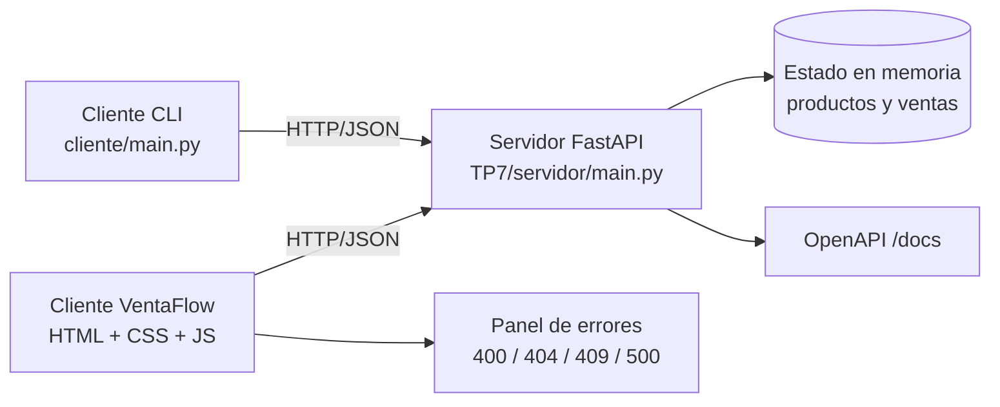

# Trabajo Práctico N° 7: Integración entre Capas y Consumo de APIs / Servicios Distribuidos

**Asignatura:** Desarrollo de Aplicaciones para Ambientes Distribuidos

**Docente:** Lic. Gabriel Artaza

**Modalidad:** Individual

**Formato de evaluación:** Repositorio + Demostración / Ejecución en vivo al cierre del cursado

**Estudiante:** Yazmin Agustina Dorado

---

## 1. Carátula e identificación

- **Nombre y apellido:** Yazmin Agustina Dorado
- **Materia:** Desarrollo de Aplicaciones para Ambientes Distribuidos
- **Cátedra:** Desarrollo de Aplicaciones para Ambientes Distribuidos
- **Lenguajes y frameworks:** Python, FastAPI, Pydantic, Uvicorn, Requests, HTML, CSS y JavaScript

---

## 2. Objetivos del trabajo práctico

1. Diseñar e implementar un servicio distribuido REST sobre HTTP/JSON.
2. Desarrollar un cliente independiente del proceso del servidor.
3. Comprender la abstracción entre capas: serialización, deserialización y errores de transporte.
4. Aplicar control de versiones, documentación técnica y evidencias de ejecución.

---

## 3. Dominio implementado

Se implementó un **servicio de ventas** con dos entidades relacionadas:

| Entidad | Campos | Descripción |
|---|---|---|
| `Producto` | `id`, `nombre`, `precio`, `stock` | Catálogo e inventario disponible. |
| `Venta` | `id`, `producto_id`, `producto_nombre`, `cantidad`, `total`, `fecha` | Operación registrada que descuenta stock. |

El total de cada venta se calcula en el servidor como `precio × cantidad`. El estado se mantiene en memoria, según lo permitido para la consigna.

---

## 4. Contrato del servicio

| Método | Endpoint | Descripción | Respuestas |
|---|---|---|---|
| `GET` | `/health` | Estado del servicio y conteos | `200` |
| `GET` | `/productos` | Lista de productos | `200` |
| `POST` | `/productos` | Crea un producto | `201`, `400`, `409` |
| `GET` | `/productos/{id}` | Detalle de un producto | `200`, `404` |
| `GET` | `/ventas` | Lista de ventas | `200` |
| `POST` | `/ventas` | Registra una venta y descuenta stock | `201`, `400`, `404`, `409` |
| `GET` | `/ventas/{id}` | Detalle de una venta | `200`, `404` |
| `GET` | `/recursos` | Endpoint original, conservado como alias | `200` |
| `GET` | `/recursos/{id}` | Endpoint original, conservado como alias | `200`, `404` |
| `POST` | `/recursos` | Endpoint original, conservado como alias | `201`, `400`, `409` |
| `GET` | `/debug/error500` | Endpoint de prueba que fuerza un `500` | `500` |

Documentación interactiva disponible en `http://localhost:8000/docs`.

---

## 5. Arquitectura



El cliente visual es una SPA estática servida por el propio FastAPI en `/`, por lo que comparte origen con la API y no necesita CORS. El cliente CLI (`cliente/main.py`) permanece como aplicación independiente que se conecta por red.

---

## 6. Estructura del repositorio

```text
TP7/
├── servidor/
│   ├── main.py
│   └── requirements.txt
├── cliente/
│   ├── index.html
│   ├── styles.css
│   ├── app.js
│   └── main.py
└── README.md
```

---

## 7. Evidencias de ejecución

> Las imágenes siguientes son evidencia de ejecuciones anteriores. Al defender el TP, reemplazarlas por capturas de esta versión: alta de producto en `Cargar productos`, lista actualizada y los cuatro códigos de error (`400`, `404`, `409`, `500`). Para el 404, usar **Probar producto 777**: el panel debe mostrar `GET /productos/777` y el detalle `Producto no encontrado`.

### Captura 1: Invocación exitosa

Petición enviada por el cliente y respuesta correcta devuelta por el servicio.


### Captura 2: Estructura de datos

Carga útil recibida en formato JSON desde el servicio.


### Captura 3: Manejo de errores

Comportamiento del sistema frente a una petición errónea o un fallo simulado.


### Captura adicional: cliente CLI


---

## 8. Instrucciones de ejecución

### 8.1 Instalar dependencias (solo la primera vez)

```powershell
cd C:\Users\Estudiante\ambiente_distribuidos\TP7\servidor; python -m pip install -r requirements.txt
```

### 8.2 Levantar y abrir con un solo comando

Copiar y pegar en PowerShell, desde cualquier carpeta:

```powershell
cd C:\Users\Estudiante\ambiente_distribuidos\TP7\servidor; Start-Process python -ArgumentList '-m','uvicorn','main:app','--reload','--host','127.0.0.1','--port','8000'; Start-Sleep 3; start http://localhost:8000/
```

Si el servidor ya está corriendo, alcanza con:

```powershell
start http://localhost:8000/
```

La URL `http://localhost:8000/` sirve la interfaz **VentaFlow**. La documentación interactiva de la API está en `http://localhost:8000/docs`.

Desde la interfaz se puede:

1. Cargar un producto con `POST /productos` y verlo en la lista de inventario.
2. Registrar una venta con `POST /ventas`.
3. Consultar ventas con `GET /ventas` y recargar el panel con **Actualizar**.
4. Probar los errores **400**, **404** (`GET /productos/777` → `Producto no encontrado`), **409** y **500** con los botones del panel; abajo se muestran el endpoint consultado y el detalle devuelto por FastAPI.

### 8.3 Ejecutar el cliente CLI independiente

```bash
cd TP7/cliente
python main.py
```

El cliente CLI demuestra el mismo contrato desde consola, con timeouts y errores controlados.

---

## 9. Control de excepciones

- `400 Bad Request`: payload inválido o `cantidad <= 0`. Botón **Probar 400**.
- `404 Not Found`: botón **Probar producto 777** → `GET /productos/777` → `detail: "Producto no encontrado"`.
- `409 Conflict`: ID duplicado o stock insuficiente. Botón **Probar 409**.
- `500 Internal Server Error`: handler genérico; se fuerza con `GET /debug/error500` y el botón **Probar 500**.
- El cliente visual muestra `código`, **endpoint consultado**, **detalle devuelto por FastAPI** y el cuerpo JSON completo de cada error.
- El cliente CLI captura `requests.RequestException` y respuestas no OK.

---

## 10. Construcción

La solución usa el patrón cliente-servidor sobre HTTP/1.1 con JSON. El servidor expone una API REST construida con FastAPI y Pydantic. El cliente visual es una SPA liviana sin dependencias externas ni build, y el cliente CLI es un proceso separado que refuerza la independencia entre capas. Se conservan los endpoints `/recursos` originales para no romper las evidencias anteriores del repositorio.
